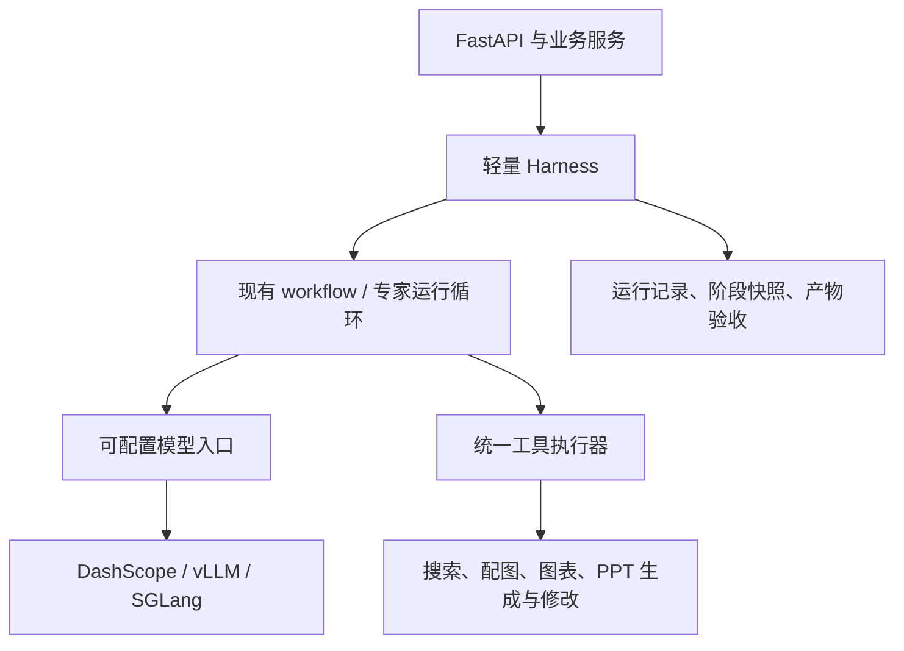

# PPT Agent 优化实施计划

> 日期：2026-10-10。本文是待实施计划，任务复选框不代表已完成。
> 执行者：后续实施时使用 `superpowers:executing-plans` 逐项推进；如用户明确选择分派执行，再使用 `superpowers:subagent-driven-development`。

**Goal：** 面向个人使用，提升开源通用模型制作 PPT 的质量、任务可靠性和运行效率，同时逐步降低框架耦合。

**Architecture：** 先在现有 workflow 上建立轻量 Harness，统一运行状态、工具执行、上下文和产物验收；再通过可配置模型入口尝试本地推理服务；最后按模块替换 LangChain 高层组件。三个阶段分别验收，保留现有业务接口和可回退的执行路径。

**Tech Stack：** Python 3.12+、FastAPI、Pydantic、asyncio、MySQL、Redis、python-pptx、Matplotlib；初期保留 LangChain / LangGraph；本地推理候选为 vLLM、SGLang。

**Spec：** 本文第 1～3 节记录设计依据与范围，来源为此前的架构讨论、当前 `AGENTS.md` 及用户指定的优先级。

## 1. 优先级与实施边界

| 优先级 | 阶段 | 要解决的问题 | 阶段出口 |
| --- | --- | --- | --- |
| P1，最高 | 轻量 Harness | 执行控制分散、失败与恢复语义不统一、产物验收不足 | 有运行基线；工具与任务受控；产物通过明确检查 |
| P2 | 尝试本地部署、推理优化 | 云端推理不可控；重复输入与多轮调用可能存在优化空间 | 有可复现的部署、兼容性测试和性能 / 质量对比报告 |
| P3 | 局部替换 LangChain 重依赖组件 | 模型、工具、消息、事件与框架耦合 | 至少一个独立模块及一个专家试点有手写实现，可切换、可比较 |

### 全局约束

- 当前任务仅新增本计划；不实施功能，不修改 `handoff.md`。
- 实施顺序固定为 P1 → P2 → P3。P2 无合适硬件或模型时，可以记录实验受阻并进入 P3；不能虚构性能结果。
- 围绕专业 PPT Agent 和个人产品做增量改造，初期不建设通用插件市场、动态热加载或复杂分布式调度系统。
- P1 首先覆盖 `workflow` 模式；现有单智能体、subagents 模式保留原实现。新增模式必须显式声明能力，不能因缺少方法而运行时失败。
- 大纲审阅、登录、配额、模板、下载和现有 SSE 事件保持兼容；确需扩展协议时同步更新前后端及回归用例。
- 任务预算、工具超时、重试次数和修订次数可配置。首次实验建议：任务 900 秒、模型请求最多 64 次、工具调用最多 128 次、单工具超时 180 秒、只读工具自动重试最多 1 次、产物修订最多 1 轮；这些是待测初始值，不是当前项目能力或性能承诺。
- 有副作用的工具默认不自动重试，只有操作记录和产物提交机制能证明安全时才允许重试。
- 每个实施任务先补针对性测试，确认失败，再实现并验证；按任务提交代码。本文编写不安装依赖、不运行模型、不操作数据库。

### Review Focus

1. 已经写入 PPT 的追加操作遭遇断流或重试：不能重复加页、重复扣配额；由任务 3 测试覆盖。
2. 配图、图表同时执行及取消：事件必须能关联各自分支，取消后的迟到结果不能提交；由任务 2、3 测试覆盖。
3. 缺少素材、结构化输出非法、生成了文件但不满足需求：应产生明确失败或降级结果；由任务 4 测试覆盖。
4. 本地端点不可用、工具调用参数不完整、流中断：不得无条件把有副作用的阶段在云端重做；由任务 5 测试覆盖。
5. 替换框架后工具调用 ID、事件及上下文不一致：必须通过协议与行为回归；由任务 7、8 测试覆盖。

## 2. 当前实现与需要保留的能力

当前仓库已拆分为 `ppt-backend/` 与 `ppt-frontend/`，下面所有代码路径以这两个目录为准。

| 现有文件 / 目录 | 当前职责 | 与计划的关系 |
| --- | --- | --- |
| `ppt-backend/app/agent/__init__.py` | 选择默认 Agent，实现模块级初始化 | 后续增加显式能力检查、按需构建与切换 |
| `ppt-backend/app/agents/workflow/agent.py` | workflow 入口、大纲审阅、阶段续跑 | Harness 的初期接入点 |
| `ppt-backend/app/agents/workflow/graph.py` | 新建流水线、专家节点、并行配图 / 图表 | 保留拓扑，接入上下文与执行控制 |
| `ppt-backend/app/agents/workflow/streaming.py` | 将 LangGraph 事件映射为 SSE | 迁移为带任务、分支关联的事件适配 |
| `ppt-backend/app/agents/common/llm.py` | DashScope 模型与 embedding 工厂 | P2 的端点配置与 P3 的客户端边界 |
| `ppt-backend/app/controller/ppt.py` | 任务创建、回调、流式响应及终态 | 保留 HTTP 路由，收敛执行和终态规则 |
| `ppt-backend/app/services/ppt_service.py` | 配额、阶段进度、任务记录 | 沿用业务持久化，复核扣减与恢复顺序 |
| `ppt-backend/app/tools/` | 生成、改写 PPT，搜索、配图、图表 | 工具执行管线和局部去框架化对象 |
| `ppt-backend/app/utils/memory.py` | Redis 近期原文与远期摘要 | 保留策略，后续解耦消息和模型类型 |
| `ppt-frontend/src/utils/sse.ts` | 前端 POST SSE 解析 | 保留外部事件格式，补必要回归 |

已经存在阶段落库、大纲人工审阅、文件锁、执行日志和记忆组件；Harness 应复用这些能力，而不是建立一套重复的业务状态。

当前还存在一个实施前置问题：`pyproject.toml`、`.env` 位于仓库根目录，但移动后的配置文件按 `ppt-backend/` 计算 `.env` 路径；根目录构建配置仍引用 `app` 和缺失的 `README.md`。任务 1 先确认并统一安装、配置及运行约定，避免将启动问题误判为 Harness 或推理问题。

## 3. 目标架构与关键取舍



- Harness 管执行约束与结果验收；workflow 管 PPT 任务步骤；模型服务管推理性能。
- P1 暂时保留 `create_agent` 和 StateGraph，通过适配器接入。仅包裹入口不足以限制内层工具，需要在模型请求和工具执行处提供控制点。
- P2 先配置当前模型工厂，使本地服务可接入，不提前要求完成原生模型客户端重构。
- P3 优先移除高层 Agent、工具和模型封装；LangGraph 可以继续作为编排器，不以完全移除所有 `langchain-*` 包作为本轮目标。
- KV Cache 缓存模型中间状态；Redis 缓存对话与业务数据。应用侧无法自行管理云端模型的 KV Cache。
- 前缀缓存收益主要来自重复输入的 prefill；输出生成、搜索下载、PPT 写入的耗时仍需分别测量。

## 4. P1：轻量 Harness

### 任务 1：统一运行入口并建立基线

**涉及文件：** 修改 `pyproject.toml`、`ppt-backend/app/core/config.py`、`ppt-backend/app/agents/common/llm.py`、`ppt-backend/app/core/observability.py`；新增 `ppt-backend/tests/test_runtime_config.py`、`ppt-backend/benchmarks/cases.json`、`ppt-backend/benchmarks/run_baseline.py`、`ppt-backend/docs/runtime.md`。

**接口与产出：** `run_baseline(cases_path: Path, output_dir: Path) -> Path` 输出报告目录；案例固定包含 `case_id`、`message`、`style`、`requirements`。结果记录模型、配置、输入 / 输出 token、调用数、阶段耗时、端到端耗时、错误与产物位置。

- [ ] 建立配置测试，验证从仓库根目录和后端目录启动都能读取同一份配置，缺少必需配置时报告字段名而不泄露值。
- [ ] 确定统一约定：根目录保留 `.env`、`pyproject.toml` 与锁文件；适配后端源码的打包路径和配置根路径，将构建的 readme 引用指向新增的 `ppt-backend/docs/runtime.md`，在运行文档中写出唯一启动方式。
- [ ] 定义 8 个固定案例：基础主题、数据调研、配图、图表、模板、大纲编辑、阶段恢复、素材失败。离线协议测试使用模拟模型；真实模型基线单独运行并标记版本。
- [ ] 为每次模型请求记录耗时与用量；供应商未提供 token 或 cache 指标时记为未知，不能记成零。任务 / 专家日志使用关联 ID。
- [ ] 验证配置用例通过，并用模拟端点跑通报告生成；保存首次真实模型基线后提交本任务。

**验收：** 有可复现的运行说明和基线格式；不会在改造后无法解释耗时变化。

### 任务 2：统一运行上下文、预算与工具执行

**涉及文件：** 新增 `ppt-backend/app/harness/{__init__,types,runtime,executor,events}.py`、`ppt-backend/app/harness/adapters/{__init__,langchain}.py`；修改 `ppt-backend/app/agents/workflow/agent.py`、`ppt-backend/app/agents/workflow/graph.py`、`ppt-backend/app/agents/workflow/streaming.py`、`ppt-backend/app/core/config.py`；新增 `ppt-backend/tests/harness/test_runtime.py`、`ppt-backend/tests/harness/test_executor.py`。

**接口与产出：**

- `RunContext`：`task_id`、`run_id`、`user_id`、预算计数、取消标记。
- `RuntimeEvent`：`task_id`、`run_id`、`event_id`、`stage`、`role`、`operation_id`、`type`、`data`。
- `ToolResult`：`success`、`data`、`error_code`、`message`、`retryable`、`degraded`。
- `ToolExecutor.execute(tool_name: str, arguments: dict, context: RunContext, operation_id: str) -> ToolResult`。
- `HarnessRuntime.stream(context: RunContext, source: AsyncIterator[RuntimeEvent]) -> AsyncIterator[RuntimeEvent]`。

- [ ] 写预算超限、工具超时、参数非法、重试耗尽测试；用短超时和模拟工具验证，不等待真实模型。
- [ ] 定义模型请求计数、工具执行计数与检查点；预算耗尽必须阻止后续调用，入口包装不能替代内层检查。
- [ ] 用 LangChain 适配器保留当前工具名称与参数 Schema，将字符串 / JSON 工具结果规范化；未知结果显式归为协议错误。
- [ ] 区分只读工具与修改文件的工具；只读失败按配置重试，有副作用工具暂不自动重试。同步渲染与 PPT 写入不能阻塞事件循环，超时后需阻止迟到产物提交。
- [ ] 事件保留现有 SSE `type`，增加可选关联字段；并行分支的角色由各自执行上下文决定，不能依赖一个全局“当前专家”。
- [ ] 设置 `HARNESS_ENABLED=false` 为初期默认，通过开启 / 关闭两条路径验证相同协议；回归通过后提交本任务。

**验收：** workflow 内层请求与工具调用能被控制；配图和图表事件不会相互串角色；关闭 Harness 可以回到原路径。

### 任务 3：阶段恢复、操作幂等和产物提交

**涉及文件：** 新增 `ppt-backend/app/harness/{persistence,artifacts}.py`、`ppt-backend/app/models/tool_operation.py`、`ppt-backend/migrations/001_tool_operation.sql`；修改 `ppt-backend/app/services/ppt_service.py`、`ppt-backend/app/controller/ppt.py`、`ppt-backend/app/tools/_ppt_lock.py` 及 PPT 写入工具；新增 `ppt-backend/tests/harness/test_recovery.py`、`ppt-backend/tests/harness/test_artifact_commit.py`、`ppt-backend/tests/harness/test_quota.py`。

**接口与产出：** `OperationStore.claim(task_id: int, operation_id: str) -> bool`、`OperationStore.complete(task_id: int, operation_id: str, result: ToolResult) -> None`；`ArtifactStore.commit(task_id: int, operation_id: str, candidate: Path, expected_version: int) -> Path`。操作表 `sys_ppt_tool_operation` 对 `(taskId, operationId)` 建唯一约束，记录参数摘要、状态、结果及产物版本，DDL 显式声明数据库默认值。

- [ ] 测试同一操作重复提交、追加页后响应丢失、生成回调与阶段回调不同顺序、配额并发扣减；断言页数与扣减次数不会增加两次。
- [ ] 保留大纲、调研、内容等现有阶段快照；在操作记录中区分未开始、执行中、已提交、失败。恢复时复用已提交结果；无法确认副作用的执行中操作进入人工核对，不盲目重放。
- [ ] PPT 修改使用任务内互斥、临时产物与版本检查后提交；文件系统提交和数据库提交间存在故障窗口，恢复逻辑通过产物标识 / 摘要对账，不宣称跨系统天然原子。
- [ ] 复核 `deduct_for_task` 的更新顺序与失败事务，定义扣费点为基础 PPT 成功提交。后续素材失败、重试、修订和续跑都不能重复扣费。
- [ ] 明确断流策略：前台运行在可取消请求处停止，已有副作用操作完成对账后停止，不再调度新阶段；人工审阅状态保留草稿；下一次请求恢复最近已提交阶段。
- [ ] 通过临时数据库与临时目录运行集成用例；清理测试数据，验证原有下载仍指向最终提交产物，再提交本任务。

**验收：** 恢复可解释、重复操作可识别、产物版本可核对；不把进程内文件锁当作跨进程锁。初期按单后端进程部署，增加 workers 前另行验证协调机制。

### 任务 4：上下文裁剪与 PPT 质量检查

**涉及文件：** 新增 `ppt-backend/app/harness/{context,validation}.py`、`ppt-backend/app/schemas/artifact.py`；修改 `ppt-backend/app/agents/workflow/graph.py`、`ppt-backend/app/controller/ppt.py`、`ppt-backend/app/tools/pexels_search.py`；必要时修改 `ppt-frontend/src/pages/ppt/PptCreatePage.vue`；新增 `ppt-backend/tests/harness/test_context.py`、`ppt-backend/tests/harness/test_validation.py`。

**接口与产出：** `build_stage_context(role: str, task_data: dict, max_chars: int) -> list[dict]`；`validate_artifact(path: Path, requirements: dict) -> ValidationReport`。`ValidationReport` 包含 `passed`、`issues`、`degraded`；每个 issue 含检查项、页码和描述。

- [ ] 测试专家只获取必要资料、超长工具结果有摘要或引用、任务与专家上下文不会串用。固定提示词与工具序列化顺序，动态数据后置；不通过填充无用 token 来追求缓存命中。
- [ ] 用角色相关资料替代无差别携带完整共享历史：内容阶段接收主题、大纲和研究笔记，素材阶段接收内容摘要、目标页及文件版本。保持合法工具调用与结果配对。
- [ ] 添加 PPT 可打开、要求页数、必需内容、图片降级、图表数据来源等确定性检查。素材缺失按任务要求判断失败或降级，错误不靠“已生成文件名”覆盖。
- [ ] 增加可选渲染检查，记录渲染器、字体与环境；未启用或不可用时显式报告“视觉检查未执行”，不能当作视觉验收通过。
- [ ] 修订最多执行配置允许的轮数，每轮产生新版本，仅修订被指出的问题；达到预算或上限后返回检查报告。暂不引入无上限的自我反思循环。
- [ ] 对比基线案例的输入量、成功率与人工评分；模拟失败路径和基础验收全部通过后提交本任务。

**P1 阶段出口：** 任务 1～4 验收通过；真实样本报告能区分基础生成、素材降级和验收结果；Harness 开关与原路径均可运行。若自动修订尚未达到质量要求，可先交付检查报告并保持修订关闭。

## 5. P2：尝试本地部署、推理优化

### 任务 5：本地模型服务与兼容性试验

**涉及文件：** 修改 `ppt-backend/app/core/config.py`、`ppt-backend/app/agents/common/llm.py`、`ppt-backend/app/agent/__init__.py`、`ppt-backend/app/agent/plain_chat_agent.py`、`ppt-backend/app/tools/content_refiner.py`；新增 `ppt-backend/deploy/local-inference.md`、`ppt-backend/tests/inference/test_endpoint_config.py`、`ppt-backend/tests/inference/test_protocol.py`。部署脚本在选定模型与运行环境后另存于 `ppt-backend/deploy/`，禁止把权重加入代码仓库。

**接口与产出：** 模型入口配置 `LLM_PROVIDER`、`LLM_BASE_URL`、`LLM_MODEL`、`LLM_API_KEY`、`LLM_TIMEOUT_SECONDS`；embedding 独立配置 `EMBEDDING_BASE_URL`、`EMBEDDING_MODEL`、`EMBEDDING_API_KEY`。原 DashScope 配置作为兼容默认值，不能因切换聊天模型而自动改变 embedding 服务。

- [ ] 记录实际硬件、内存 / 显存、操作系统与可用权重，选择一个中文与工具调用能力可验证的模型；不预设某个云端 API 模型可以下载自部署。
- [ ] 先选 vLLM 或 SGLang 其中一个建立可运行基线，固定引擎版本、模型 revision、精度 / 量化方式、聊天模板和 parser；按该组合的官方文档生成部署说明。
- [ ] 将模型工厂中的硬编码端点改为可配置，沿用当前 LangChain 模型封装；覆盖 workflow 专家、内容精炼、摘要和纯聊天的实际模型调用，避免主模型已本地化而工具内部仍请求云端。旧 Agent 按选择模式构建，避免未使用的旧实现要求云端密钥；用模拟端点测试配置切换、鉴权与独立 embedding。
- [ ] 验证中文对话、工具调用及其 ID、流式工具参数拼装、JSON 输出、大纲生成和完整 PPT 创作；结构化 JSON 合法不等于内容符合需求。
- [ ] 本地服务故障以明确错误结束；只在任务启动前显式选择云端回退，或在能证明没有已提交副作用时恢复。记录实际提供服务的模型与端点，禁止无记录地切换模型。
- [ ] 将硬件足够 / 不足、模型可用 / 不可用及兼容性结果写入实验报告，再提交本任务。

**验收：** 一个本地部署组合完成协议验收，或形成明确的阻碍记录。云端运行路径仍可用。

### 任务 6：缓存、并发与模型分工的受控实验

**涉及文件：** 新增 `ppt-backend/benchmarks/run_inference.py`、`ppt-backend/benchmarks/report.py`；按实验结果修改模型工厂、提示词组装和配置；报告写入 `ppt-backend/benchmarks/results/<实验标识>/`。

**接口与产出：** `run_inference(cases_path: Path, experiment_config: Path, output_dir: Path) -> Path`；配置记录引擎、模型、硬件、并发数、缓存状态、输入 / 输出上限和种子（服务支持时）。每份报告同时提供原始数据和摘要。

- [ ] 先在同一模型、硬件和精度下比较引擎或缓存开关；固定案例和生成参数，报告服务是否支持可复现种子。
- [ ] 比较冷缓存、热缓存；并发先测 1、2、4，出现 OOM、频繁抢占或质量下降时停止继续增压。缓存的初始化、清空和命中判据写入报告。
- [ ] 记录 TTFT、输出 token 速度、端到端耗时、吞吐、显存、错误率，以及服务可提供的缓存指标。初步实验每组合至少 5 次；p95 的判定实验至少 30 次，标明样本量。
- [ ] 云端对照记录 `cached_tokens`（若支持）；本地对照使用对应引擎指标。缓存必须匹配 token 前缀，换角色、工具集合、模板或摘要会影响命中。
- [ ] 检查任务耗时分布，再分别实验长输入缓存、并发、量化或小模型分工；小模型只先试意图分类与摘要，PPT 内容质量单独评分，不将换模型收益归因于引擎。
- [ ] 用相同质量要求计算每份合格 PPT 的耗时与资源成本，给出“采用、继续实验或保留云端”的结论；不预设 vLLM 或 SGLang 必然更快，再提交本任务。

**P2 阶段出口：** 有部署兼容性结果和受控实验报告。只有质量、稳定性与目标性能同时满足时才调整默认服务；没有正收益也属于有效实验结论。

## 6. P3：局部替换 LangChain 重依赖组件

### 任务 7：解耦基础工具、消息与模型客户端

**涉及文件：** 新增 `ppt-backend/app/llm/{__init__,types,client}.py`、`ppt-backend/app/tools/registry.py`；先修改 `ppt-backend/app/tools/file_tools.py`、`ppt-backend/app/tools/content_refiner.py`、`ppt-backend/app/utils/memory.py` 与 Harness 适配器；新增 `ppt-backend/tests/native/test_client.py`、`ppt-backend/tests/native/test_tools.py`、`ppt-backend/tests/native/test_memory.py`。如采用 API SDK，在根目录 `pyproject.toml` 显式声明依赖，不能依赖 LangChain 间接安装。

**接口与产出：**

- `Message` 使用协议字段：`role`、`content`、可选 `tool_calls`、`tool_call_id`。
- `ModelRequest` 包含模型、消息、工具 Schema、生成参数与可选输出约束；`ModelResult` 包含消息、用量和结束原因；`ModelDelta` 为带请求 ID 的流式增量。
- `ModelClient.complete(request: ModelRequest) -> ModelResult`、`ModelClient.stream(request: ModelRequest) -> AsyncIterator[ModelDelta]`。
- `ToolRegistry.get(name: str) -> ToolSpec`；`ToolSpec` 提供名称、描述、参数 Schema、处理函数和副作用声明，由任务 2 的执行器统一运行。

- [ ] 通过模拟 API 测试普通回复、多个工具调用、跨多个 chunk 的参数、未知 finish reason 和中途断流；使用 Pydantic 校验参数与结构化结果。
- [ ] 将文件工具的业务逻辑变为普通异步函数，在 LangChain 适配器中生成兼容工具；工具名和参数不变，同时验证工作区真实路径边界。
- [ ] 内容精炼与摘要改为依赖 `ModelClient`，记忆内部保存协议消息；保留 Redis key 和摘要策略，存量记录可读取。
- [ ] 模型客户端只负责协议、连接和响应；运行预算、工具选择、重试副作用与产物质量仍由 Harness 负责。
- [ ] 对迁移模块运行原生 / 适配路径的契约测试；用相同案例评估调用数、token 与行为变化，再提交本任务。

**验收：** 文件工具、内容精炼和记忆的业务核心不直接依赖 `ChatOpenAI`、`BaseMessage`、`@tool`；现有专家经适配器仍可使用这些模块。

### 任务 8：一个专家的手写 ReAct 试点

**涉及文件：** 新增 `ppt-backend/app/harness/react.py`；修改 `ppt-backend/app/agents/research_agent.py`、`ppt-backend/app/agents/workflow/graph.py`、`ppt-backend/app/core/config.py`、`ppt-backend/app/tools/tavily_search.py`、`ppt-backend/app/tools/registry.py` 及 LangChain 适配器；新增 `ppt-backend/tests/native/test_react.py`、`ppt-backend/tests/native/test_research_contract.py`。将调研工具业务逻辑与装饰器解耦，注册搜索和读取工具，底层联网实现保持原行为。

**接口与产出：** `ReactRunner.run(messages: list[Message], tool_names: list[str], context: RunContext) -> ModelResult`；通过 `NATIVE_RESEARCH_ENABLED=false` 控制调研专家试点，依赖任务 7 的客户端与注册表、任务 2 的执行器与事件。

- [ ] 测试模型回复 → 工具调用 → 工具结果 → 下一次模型请求的配对；覆盖多工具调用、非法参数、失败结果、预算耗尽和取消。
- [ ] 用一套通用循环实现 research 专家，不给每个角色复制独立循环；只有无工具调用且结果符合研究笔记契约时才结束。
- [ ] 保持 workflow 消费的研究笔记格式与阶段回调不变；原生执行直接产生 Harness 事件，再转换为已有 SSE 格式，不继续反向解析框架事件。
- [ ] 使用固定案例比较手写与原实现的研究质量、调用数、token、首次响应、依赖及调试复杂度；相同提示词与模型下先做协议回归，再评价质量。
- [ ] 验证关闭试点可立即恢复原专家，提交结果。达到目标后另开任务扩展其他角色；当前计划不要求移除 LangGraph 或全部旧 Agent。

**P3 阶段出口：** 局部业务模块完成解耦，一个专家具有可切换的原生循环。只有剩余运行路径都不依赖某个包时才从依赖表移除它；保留 LangGraph 时允许保留其传递依赖。

## 7. 验证、指标与回退

### 实施期间的验证入口

以下目录和测试是本计划拟新增的产物。任务 1 的环境修正完成后，在 `ppt-backend/` 下使用安装了测试依赖的 Python 环境运行：

```bash
python -m pytest tests/test_runtime_config.py -q
python -m pytest tests/harness -q
python -m pytest tests/inference -q
python -m pytest tests/native -q
```

测试依赖在实施时加入开发依赖组。真实推理、联网素材、临时数据库、渲染检查使用独立标记或显式参数；离线测试不得意外调用付费 API 或写入实际业务数据。涉及前端协议时，在 `ppt-frontend/` 执行 `npm run type-check` 与 `npm run build-only`，并人工验证审阅、续跑及下载流程。

### 评价维度

| 维度 | 判定方式 |
| --- | --- |
| 可靠性 | 故障注入后的可恢复阶段；重复加页 / 扣费次数；取消后迟到提交次数 |
| PPT 质量 | 需求满足、数据来源、内容结构、素材相关性；按同一 1～5 分量表人工评分 |
| 性能 | 模型 TTFT、每阶段耗时、端到端耗时、同硬件吞吐及显存 |
| 资源成本 | 每份通过验收的 PPT 的模型用量、失败重试和本地算力成本 |
| 轻量化 | 核心模块直接依赖、安装环境、启动耗时及同一故障的定位复杂度 |

不预设加速倍数、缓存命中率或质量提升幅度。评估框架变化时保持模型与任务一致；评估推理引擎时保持模型权重、精度、硬件与输入一致；更换模型时单列质量对比。

### 回退方式

- Harness：关闭 `HARNESS_ENABLED`，恢复原 workflow 运行路径；新增操作表保留记录，回退期间不启用副作用工具自动重试。
- 本地推理：显式切换模型端点到原云端配置，从已提交阶段恢复；正在执行的操作先完成对账。
- 原生专家：关闭 `NATIVE_RESEARCH_ENABLED`，恢复原 LangChain 专家；保留工具适配器和消息兼容性。
- 涉及数据库或产物格式变化时提供向前兼容的迁移，不能通过删除任务记录或覆盖用户文件完成回退。

## 8. 实施参考

以下资料用于解释设计思路，具体部署版本、模型支持和参数应在任务 5 执行时重新核对。

- [DeepSeek Harness 架构](https://github.com/deepseek-ai/deepseek-harness/blob/master/docs/architecture.md)：可替换的模型、工具、运行循环与会话事件边界。
- [DeepSeek 工具执行管线](https://deepseek-harness.github.io/deepseek-harness/en/reference/tool-execution-pipeline)：工具调用前后扩展点与结果观察。
- [vLLM Automatic Prefix Caching](https://docs.vllm.ai/en/latest/features/automatic_prefix_caching/)：共享前缀的复用及 prefill 收益边界。
- [vLLM Tool Calling](https://docs.vllm.ai/en/stable/features/tool_calling/)：工具调用与模型 parser / 输出约束的兼容性。
- [SGLang 官方仓库](https://github.com/sgl-project/sglang)：部署、模型与硬件支持的入口。
- [百炼上下文缓存](https://help.aliyun.com/zh/model-studio/context-cache)：云端缓存支持与命中用量。
- [LangGraph 概览](https://docs.langchain.com/oss/python/langgraph/overview)：保留编排运行时、替换高层 Agent 组件的可行路径。
