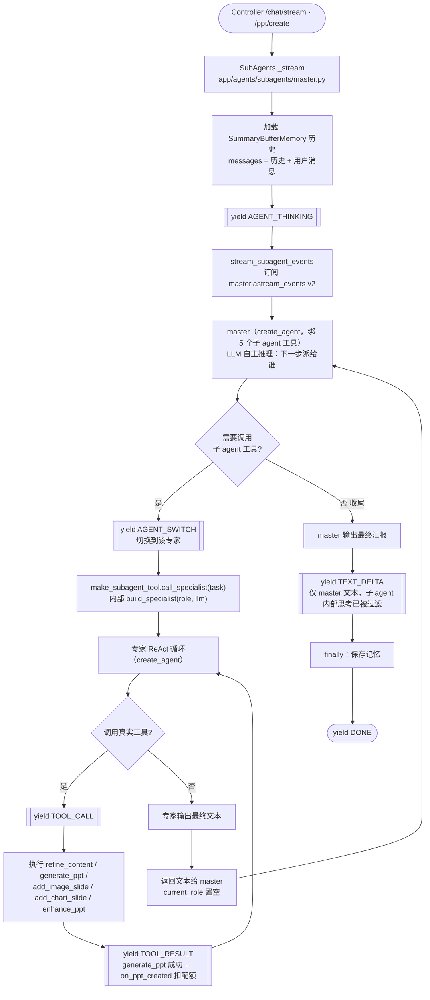
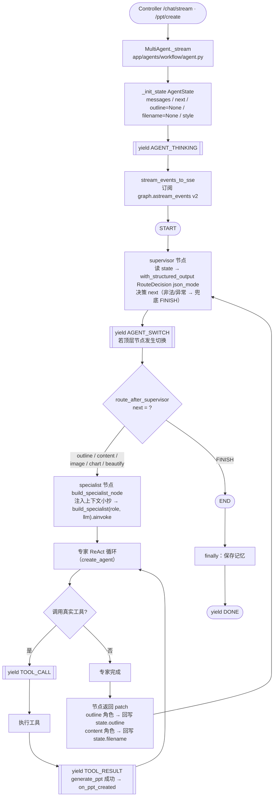

# 多智能体流程图（subagents / workflow）

> 对应代码：`app/agents/subagents/` 与 `app/agents/workflow/`
> 两图均以「创建 PPT」请求（`POST /ppt/create`）为主线；对话 `/chat/stream` 走法相同，只是不带 `on_ppt_created` 配额回调。
> 图中 `[[ yield XXX ]]` 节点 = 该处向前端推送的 SSE 事件。

---

## 一、subagents 模式（主 agent 工具委托）

核心：**一个 master agent（`create_agent`）运行时自主决定调用哪个子 agent 工具**；每个子 agent 工具内部跑一个 specialist ReAct，结果回 master 继续推理。

**典型 PPT 流水线**（master 通常按此顺序派活，上下文靠 task 自然语言传递）：
1. master → `outline_agent`：输出大纲结构 JSON；
2. master → `content_agent`：**task 内贴入大纲全文** → 内部 `refine_content` + `generate_ppt` 生成 `.pptx`，返回文件名；
3. master → `image_agent`：task 内带文件名 + 英文关键词；
4. master → `beautify_agent`：task 内带文件名 → `enhance_ppt(layout/decorate/beautify)`；
5. master 汇报最终文件名。

---

## 二、workflow 模式（StateGraph + Supervisor 路由）

核心：**`StateGraph` 固定拓扑**——`supervisor` 节点用 `with_structured_output(json_mode)` 单次决策路由，每个 specialist 执行完回到 supervisor，循环直至 `FINISH`。专家间靠 `AgentState` 字段（`outline`/`filename`）显式传值。

**典型 PPT 流水线**（每步之间都有一个 supervisor 路由决策，前端被过滤不显示）：
1. `supervisor`（无大纲无文件）→ `outline`：回写 `state.outline` → supervisor；
2. `supervisor` → `content`：读 `state.outline` → `refine_content` + `generate_ppt`，回写 `state.filename` → supervisor；
3. `supervisor` → `beautify`：读 `state.filename` → `enhance_ppt` → supervisor；
4. `supervisor` → `FINISH` → `END`。

---

## 三、两图对照要点

| 维度 | subagents | workflow |
|---|---|---|
| 谁决定下一步 | master agent 自主推理 | supervisor 单次结构化决策 |
| 专家间传值 | master 把上下文写进 `task` | `AgentState` 字段（outline/filename） |
| 循环方式 | master 工具调用往返 | StateGraph：specialist → supervisor 回边 |
| 流式「专家切换」来源 | `on_tool_start` 且 name ∈ `{role}_agent` | `on_chain_start` 且 name ∈ `ROLE_NODES` |
| 文本过滤 | 只推 master 文本（`current_role is None`） | 只推非 supervisor 文本（过滤路由 JSON） |
| 兜底 | `GraphRecursionError` → ERROR | supervisor 非法/异常 → FINISH；超步数 → ERROR |

> 两模式入口方法签名一致（`run_stream / run_ppt_stream / clear_history`），controller 通过 `app/agent/__init__.py` 的 `default_stream_agent` 统一调用，由 `.env` 的 `AGENT_MODE` 决定实际跑哪个。
